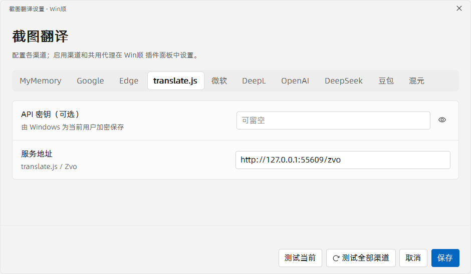

# 截图翻译 0.4.0

WinShun 原生翻译插件，支持截图翻译、剪贴板翻译、划词翻译和鼠标指词 OCR。**不需要安装 Python、PySide6 或 Qt。**

插件 ID：`iuuuuuuuu.screenshot-translate`。本版使用 C++ / Qt Quick 和 Windows OCR，安装包自带 Qt 6.10.0 及 Visual C++ 运行库。社区原生插件按官方规则标记为**未审核**；源码公开和文件校验不等于代码安全审核。

## 安装与升级

需要 **Windows 10/11 x64、WinShun 0.22.0 或更新版本**，以及系统已安装的 OCR 语言包。

1. 从 [0.4.0 发布页](https://github.com/iuuuuuuuu/winshun-screenshot-translate/releases/tag/v0.4.0) 下载 `iuuuuuuuu.screenshot-translate-0.4.0.wsplugin`。
2. 打开 WinShun 设置 → 插件 → 从压缩包安装，选择这个文件，查看并允许所需权限。
3. 更新后检查插件卡片版本为 **0.4.0**。官方插件库收录状态以对应更新 PR 的合并结果为准。

从 0.3.3 升级继续使用原有渠道、密钥、代理、热键及偏好；不需要重新安装 Python 依赖。原先明确清空或自定义的热键优先于新版默认值，请在插件设置中检查。不要同时启用早期本地 `winshun.screenshot-translate` 与当前社区版。

### 翻译管理员软件中的选中文字

例如 Codex 以管理员身份运行时：

1. 先从托盘退出 WinShun，再以管理员身份启动；也可以使用 WinShun 自带的“以管理员身份重新启动”。
2. 在设置 → 插件 → 截图翻译中允许新增的“跟随 Win顺 的管理员权限”。
3. 如果卡片显示需要确认，点击“确认”。WinShun 会建立受保护的插件副本；出现管理员盾牌后，再选中文字并按划词热键。

只重新打开一个管理员 WinShun 窗口，可能仍由原先的普通实例接管。插件日志中的 `selection-reader=administrator` 才表示实际以管理员权限运行。

普通启动 WinShun 时插件照常以普通权限运行；插件不自行弹出 UAC。每次手动更新后，WinShun 可能要求重新确认管理员副本。没有公开选区接口的软件仍需使用鼠标 OCR。

## 四个翻译入口

| 默认快捷键 | 功能 | 操作 |
|---|---|---|
| Alt+Shift+T | 截图翻译 | 框选区域，原位置显示译文；支持上下双语对照 |
| Alt+Shift+C | 剪贴板翻译 | 读取剪贴板文字，在鼠标附近显示原文和译文 |
| Alt+Shift+W | 划词翻译 | 先选中文字，再按热键，在选区附近显示译文 |
| Alt+Shift+O | 鼠标指词 OCR | 鼠标停在单词或短句上，按热键识别并翻译，无需选中 |

快捷键均可修改或清空。搜索入口为 `jst`、`jft`、`jsel`；`jst` 支持 Enter 框选、Ctrl+Enter 全屏和 Shift+Enter 当前窗口。

### 词义小窗

- 原文默认可直接编辑，保留正文样式和面板底色；聚焦时只显示文字光标，没有额外的下划线和输入框高亮。
- Enter 或“重新翻译”提交修改，Shift+Enter 换行，“还原”放弃修改。
- 点击图钉或拖动标题可固定窗口；固定后，新选区自动更新。编辑草稿期间暂停跟随。
- “重试”保留原来的目标窗口与位置，不会越点越往下移动。
- 关闭小窗或触发新的翻译会取消旧请求；未固定时点击外部关闭，可在设置中更改。

### 截图与 OCR

- 多屏各自显示完整蒙版，支持跨屏选择；拖动过程中不缩放整屏画面，选区与贴图保持物理像素尺寸。
- 恢复识别和翻译加载动画，小选区使用紧凑提示。
- 双语对照上下排列，默认译文在上，可切换为原文在上。
- 语言菜单在独立窗口展开，支持一键测试全部十个渠道。
- 修复固定小窗移动后背景、按钮异常消失的问题。
- 鼠标 OCR 可识别短句和同一段落内的相邻换行；改进小字号英文漏字和词内错误空格。
- 中英文混排时，指向少数语言通常只取所在片段；指向主要语言时保留整句。原文始终可以手动修正。

以上图片来自独立测试桌面和合成文本；设置图中的本地地址用于测试，不是默认服务地址。

## 翻译渠道与自动降级

| 渠道 | 默认地址 | 配置 |
|---|---|---|
| MyMemory | `https://api.mymemory.translated.net/get` | 无密钥 |
| Google | `https://translate.googleapis.com/translate_a/single` | 无密钥，多客户端重试 |
| Edge / Bing | `https://api-edge.cognitive.microsofttranslator.com/translate`；Bing 备用路径 | 无密钥，认证入口可能变化 |
| translate.js / Zvo | `https://api.translate.zvo.cn/translate.json` | 免费入口无需密钥 |
| 微软 Azure | `https://api.cognitive.microsofttranslator.com` | API 密钥、区域 |
| DeepL | `https://api-free.deepl.com` | API 密钥 |
| OpenAI | `https://api.openai.com/v1` | API 密钥、地址、模型 |
| DeepSeek | `https://api.deepseek.com` | API 密钥、模型 |
| 豆包 | `https://ark.cn-beijing.volces.com/api/v3` | API 密钥、模型/接入点 |
| 混元 | `https://api.hunyuan.cloud.tencent.com/v1` | API 密钥、模型 |

渠道配置窗口平铺显示十个渠道。切换配置页不会改变正在使用的渠道。“测试全部渠道”最多同时测试三个；未配置密钥的服务跳过。

自动降级默认开启，会记住失败渠道，冷却期间跳过。恢复间隔默认 **10 分钟**，可配置 **1–1440 分钟**；到期后的下一次翻译会重试主渠道，不会在空闲时持续请求。修改地址、密钥或代理后立即重新尝试。免费入口可能限流或失效，配置付费备选后降级请求可能产生相应服务费用。

## 数据与权限

截图在本机内存中识别，不上传截图；识别或输入的文字发送到选定或临时降级的翻译服务，也可能发送到用户填写的自定义地址。

- `ui`：显示设置、截图与翻译窗口，注册快捷键。
- `processes`：启动可超时回收的原生选区读取子进程。
- `clipboard:read` / `clipboard:write`：读取剪贴板翻译、复制译文。
- `network`：连接翻译服务。
- `files:write`：保存本插件的渠道、用量与失败记忆。
- `elevated`：经 WinShun 确认后跟随管理员主程序，读取管理员软件选区。

数据位于 `%LOCALAPPDATA%/WinShun/plugins/iuuuuuuuu.screenshot-translate.data`。密钥使用 Windows DPAPI 当前用户加密；日志不记录选中文字、截图、密钥或服务响应正文。读取选区不模拟复制快捷键、不修改剪贴板。

## 验证与限制

普通权限与管理员权限分别进行独立桌面回归，覆盖真实 Windows 选区读取、编辑、固定跟随、重试位置、OCR、截图几何、外部点击关闭和阻塞请求取消。Chromium 选区另有独立测试。真实管理员 Codex 的划词问题已由使用者确认修复。

OCR 仍受清晰度、字体、背景和系统语言包影响。很小文字经过缩放后仍可能混淆 `i/1` 等字符，复杂多栏或长段落也可能截断。付费渠道使用本地协议模拟测试，不代表每个真实账号均已验证可用。

## 源码、构建与许可

[中文更新记录](CHANGELOG.md) · [构建与验证说明](native/README.md) · [第三方许可](THIRD_PARTY_NOTICES.md)

公开发布使用标签 `v0.4.0` 对应源码；安装包内 `BUILD-INFO.json` 记录确切提交与 Qt 版本。GitHub Actions“原生构建与打包”从标签构建并保留日志、安装包与校验值。

插件自己的代码采用 MIT。Qt 6.10.0 动态库按 LGPL v3 分发，原始许可、依赖清单及来源随包提供；Visual C++ 运行库、阿里巴巴普惠体和 Phosphor 图标分别遵循各自许可。允许按 Qt 的许可替换兼容动态库及调试修改；经 WinShun 管理员授权的副本修改后需重新确认。
