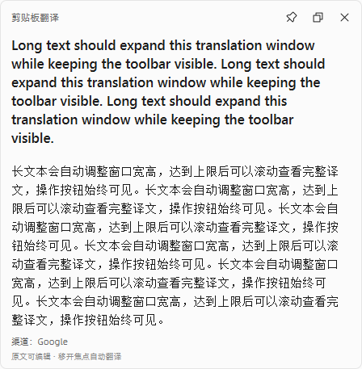
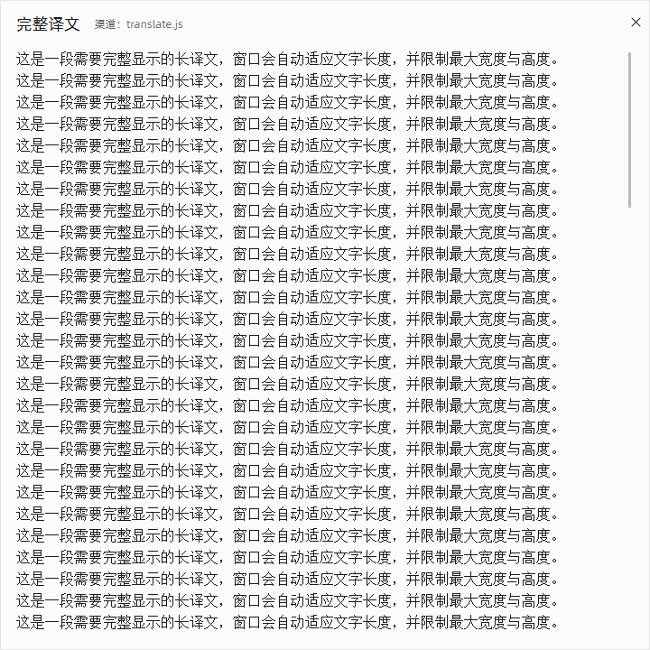
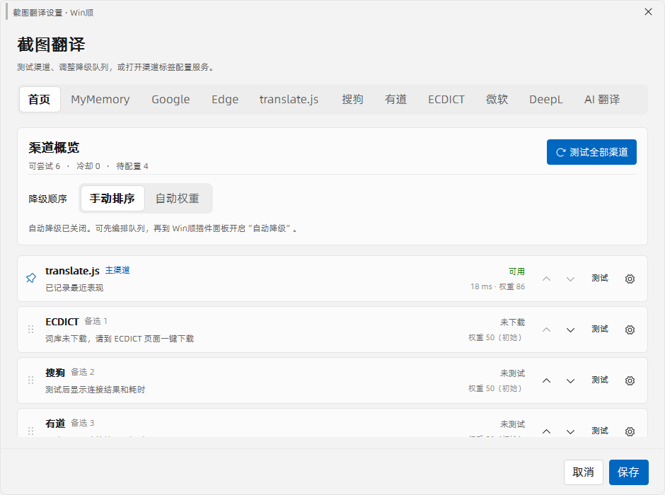
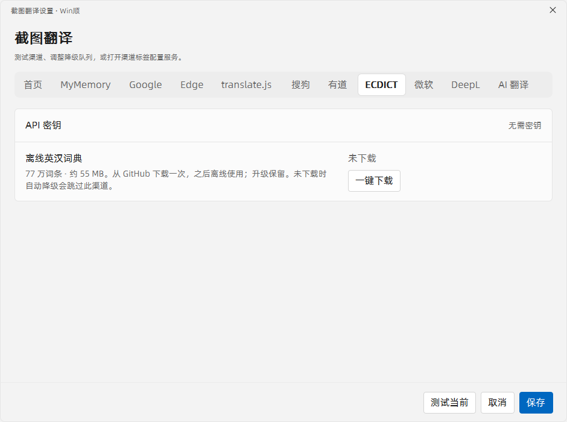
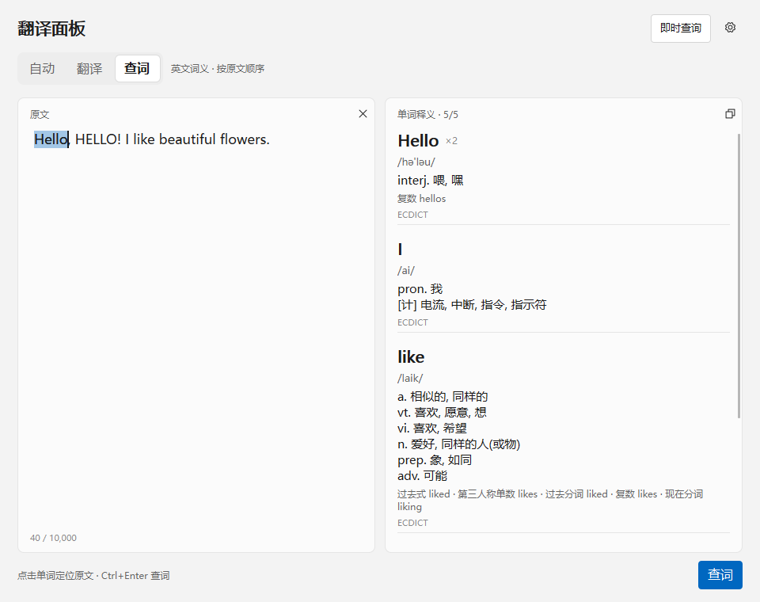

# 截图翻译 0.4.9

WinShun 原生翻译插件，支持截图翻译、剪贴板翻译、划词翻译和鼠标指词 OCR。**不需要安装 Python、PySide6 或 Qt。**

插件 ID：`iuuuuuuuu.screenshot-translate`。本版使用 C++ / Qt Quick 和 Windows OCR，通过官方契约复用 WinShun 的 Qt 6.12，安装包不再包含 Qt DLL、平台插件或 QML 运行库。社区原生插件按官方规则标记为**未审核**；源码公开和文件校验不等于代码安全审核。

## 多渠道 AI 与独立翻译面板

在插件设置中打开渠道配置，进入 **AI 翻译** 标签：添加渠道并填写名称、兼容 OpenAI 的服务地址和密钥，然后添加此渠道的模型。渠道、模型都可以启用、禁用和上下排序，点击 **保存** 后生效。首页可以启停其他翻译渠道。

开启已有的自动降级后，手动模式按渠道、模型顺序尝试；自动权重模式按近期成功率和响应速度选择。每个 AI 渠道和模型分别记录失败冷却与恢复，禁用项不会发出请求。关闭自动降级时，只请求首个启用的模型。已有单组 AI 配置会继续使用，首次进入配置页时呈现为默认渠道；所有渠道密钥仍由 Windows 加密保存。

使用关键词 **`jfy`** 或 **`翻译面板`**，也可以点击渠道设置中的 **打开独立翻译面板**。左侧输入或粘贴原文，右侧显示译文；停止输入约 700 毫秒后自动翻译，`Ctrl+Enter` 可立即提交。可以切换源语言、目标语言，或使用自动检测与中英互译。关闭自动翻译后用翻译按钮提交。输入法组词期间暂停，修改内容或关闭窗口会取消旧请求。

下方释义与译文分别显示来源。英文词语优先使用已下载且启用的 ECDICT；已配置的 AI 渠道可解释词语、短语和句子。每次最多输入 10,000 个字符，长文本在正文内滚动。面板使用插件当前的主渠道、代理与降级设置。

## 安装与升级

需要 **Windows 10/11 x64、WinShun 0.23.0 或更新版本**，以及系统已安装的 OCR 语言包。

1. 从 [0.4.9 发布页](https://github.com/iuuuuuuuu/winshun-screenshot-translate/releases/tag/v0.4.9) 下载 `iuuuuuuuu.screenshot-translate-0.4.9.wsplugin`。
2. 打开 WinShun 设置 → 插件 → 从压缩包安装，选择这个文件，查看并允许所需权限。
3. 更新后检查插件卡片版本为 **0.4.9**。新版通过检查后由官方插件库自动同步；安装和每次更新仍需用户确认。

从 0.3.3 / 0.4.0 升级继续使用原有渠道、密钥、代理、热键及偏好；不需要重新安装 Python 依赖。原先明确清空或自定义的热键优先于新版默认值，请在插件设置中检查。不要同时启用早期本地 `winshun.screenshot-translate` 与当前社区版。

WinShun 0.23.0 起，共享 Qt 支持 `elevated`。本版声明 `runtime.qt: "host"` 和 `runtime.qtVersion: "6.12.0"`，普通和管理员模式均从宿主指定的目录加载 Qt，保留管理员软件划词。宿主 Qt 主次版本必须为 6.12；不兼容时启动前显示原因。旧版 WinShun 请先更新，0.4.6 安装包仍保留供回退。详见 [官方共享 Qt 契约](https://github.com/LingCore/WinShun/blob/v0.23.0/docs/plugins.md#原生插件的共享-qt-契约最低-0220)。共享运行库主要节省下载和磁盘空间，插件仍是独立进程，不保证内存同比下降。

### 翻译管理员软件中的选中文字

例如 Codex 以管理员身份运行时：

1. 先从托盘退出 WinShun，再以管理员身份启动；也可以使用 WinShun 自带的“以管理员身份重新启动”。
2. 在设置 → 插件 → 截图翻译中允许新增的“跟随 Win顺 的管理员权限”。
3. 如果卡片显示需要确认，点击“确认”。WinShun 会建立受保护的插件副本；出现管理员盾牌后，再选中文字并按划词热键。

只重新打开一个管理员 WinShun 窗口，可能仍由原先的普通实例接管。插件日志中的 `selection-reader=administrator` 才表示实际以管理员权限运行。

普通启动 WinShun 时插件照常以普通权限运行；插件不自行弹出 UAC。每次手动更新后，WinShun 可能要求重新确认管理员副本。没有公开选区接口的软件仍需使用鼠标 OCR。

## 四个翻译入口

| 默认快捷键 | 功能 | 操作 |
|---|---|---|
| Alt+Shift+T | 截图翻译 | 框选区域，原位置显示译文；支持上下双语对照 |
| Alt+Shift+C | 剪贴板翻译 | 读取剪贴板文字，在鼠标附近显示原文和译文 |
| Alt+Shift+W | 划词翻译 | 先选中文字，再按热键，在选区附近显示译文 |
| Alt+Shift+O | 鼠标指词 OCR | 鼠标停在单词或短句上，按热键识别并翻译，无需选中 |

快捷键均可修改或清空。搜索入口为 `jst`、`jft`、`jsel`；`jst` 支持 Enter 框选、Ctrl+Enter 全屏和 Shift+Enter 当前窗口。

### 词义小窗

- 原文和译文较长时，小窗自动增加宽高；短词恢复紧凑大小。最大为 720 × 720 逻辑像素，且不超过所在屏幕可用宽高的 80%，超出内容可滚动查看；截图的“完整译文”窗口使用同样限制。
- 原文默认可直接编辑，保留正文样式和面板底色；聚焦时只显示文字光标，没有额外的下划线和输入框高亮。
- 编辑后离开输入框自动翻译，Enter 立即提交，Shift+Enter 换行；原文末尾的还原图标放弃未提交的修改。
- 只有点击图钉才固定窗口；拖动标题只移动位置。固定后，新选区自动更新，编辑草稿期间暂停跟随。
- “重试”保留原来的目标窗口与位置，不会越点越往下移动。
- 关闭小窗或触发新的翻译会取消旧请求；未固定时点击外部自动关闭，取消固定后恢复该行为。“点击其他区域关闭贴图”设置只影响截图贴图。

长段落自动展开，超长内容达到上限后滚动查看：

### 截图与 OCR

- 多屏各自显示完整蒙版，支持跨屏选择；拖动过程中不缩放整屏画面，选区与贴图保持物理像素尺寸。
- 恢复识别和翻译加载动画，小选区使用紧凑提示。
- 工具栏高 32px，全部功能直接显示；小选区不折叠按钮。首次识别为空时补试英文识别器与放大留白，改进 `Hi` 等小字识别。
- 双语对照上下排列，默认译文在上，可切换为原文在上。
- 语言菜单在独立窗口展开，支持一键测试全部十个渠道。
- 修复固定小窗移动后背景、按钮异常消失的问题。
- 鼠标 OCR 可识别短句和同一段落内的相邻换行；改进小字号英文漏字和词内错误空格。
- 中英文混排时，指向少数语言通常只取所在片段；指向主要语言时保留整句。原文始终可以手动修正。

以上图片来自独立测试桌面和合成文本，展示新版小窗、渠道首页与紧凑工具栏。

## 翻译渠道与自动降级

截图工具栏、完整译文和 OCR / 剪贴板 / 划词的小窗会直接显示实际使用的渠道；发生自动切换时显示“已降级”并使用提醒色，悬浮可查看说明。未降级时保持默认颜色，恢复主渠道后自动还原。
词义小窗的原文可直接编辑，离开输入框自动翻译；Enter 立即提交，Shift+Enter 换行。原文末尾的还原图标仅在有修改且鼠标悬浮原文区域时显示，用于撤销尚未提交的修改，底部不再放翻译 / 还原按钮。
关键字 `jft` 的结果副标题也包含渠道。尚未取得结果时显示等待状态，不把选定的主渠道误当作实际结果来源。

| 渠道 | 默认地址 | 配置 |
|---|---|---|
| MyMemory | `https://api.mymemory.translated.net/get` | 无密钥 |
| Google | `https://translate.googleapis.com/translate_a/single` | 无密钥，多客户端重试 |
| Edge / Bing | `https://api-edge.cognitive.microsofttranslator.com/translate`；Bing 备用路径 | 无密钥，认证入口可能变化 |
| translate.js / Zvo | `https://api.translate.zvo.cn/translate.json` | 免费入口无需密钥 |
| 微软 Azure | `https://api.cognitive.microsofttranslator.com` | API 密钥、区域 |
| DeepL | `https://api-free.deepl.com` | API 密钥 |
| 搜狗 | `https://fanyi.sogou.com/text` | 无密钥，公开网页翻译 / 词典；遇到限流或验证时可自动降级 |
| 有道 | `https://dict.youdao.com/jsonapi` | 不填密钥可英汉查词；填写应用 ID 和密钥后使用官方 `https://openapi.youdao.com/api` 翻译整句 |
| ECDICT | GitHub Release 独立词库 | 770,611 个词条，英汉单词及收录短语；设置中一键下载，之后完全离线 |
| AI 翻译 | 默认 `https://api.openai.com/v1`，可自定义 | OpenAI 兼容 URL、API 密钥、模型名；支持 DeepSeek、豆包、混元等兼容服务 |

设置默认打开首页，集中显示十个渠道的状态、测试耗时、权重和冷却时间；可逐个测试或直接打开配置。
“测试全部渠道”已移到首页，最多同时测试三个，以 `hello` 检查连接，不触发降级；未配置密钥或模型的服务跳过。
切换渠道配置页不会改变正在使用的主渠道。

首页可选择两种降级顺序，点击“保存”生效：

- **手动排序**：拖动左侧手柄，或点击上下按钮调整备用渠道，失败后从上往下尝试。
- **自动权重**：按近期成功率与成功响应速度排列备用渠道，测试和实际翻译都会更新权重，重启后保留。

两种模式都优先使用 WinShun 插件面板中选定的主渠道。自动模式跳过冷却和未配置渠道，同权重保留手动顺序。
切换模式不丢弃手动队列；取消关闭不会保存排序修改。词典未收录、未配置和主动取消不降低权重。

AI 只保留一个配置页，自动迁移原选中的 AI 服务；旧服务的加密配置仍保留。URL 可填基础地址或完整 `/chat/completions` 地址，模型名需由对应服务商提供。

有道免密钥入口和 ECDICT 是词典，不能翻译任意长句。开启自动降级后，长句或未收录词继续交给其他可用服务；这种情况不会将词典标记为故障。ECDICT 通过文件索引按需读取，不会在启动时将整个词库载入内存。

在设置 → ECDICT 点击“一键下载”，从本仓库 GitHub Release 获取约 55 MiB 词库，可查看进度、取消和失败重试。下载使用共用代理或系统代理，校验固定大小与 SHA-256 后才启用；中断不会覆盖已有词库。词库保存到插件数据目录的 `dictionaries/ecdict.bin`，升级保留，普通与管理员模式共用。关闭设置窗口后下载继续；不需要下载词库也可以使用其他渠道，自动降级会跳过尚未下载的 ECDICT。

自动降级默认开启，会记住失败渠道，冷却期间跳过。恢复间隔默认 **10 分钟**，可配置 **1–1440 分钟**；到期后的下一次翻译会重试主渠道，不会在空闲时持续请求。修改地址、密钥或代理后立即重新尝试。免费入口可能限流或失效，配置付费备选后降级请求可能产生相应服务费用。

## 数据与权限

关闭全部翻译和设置窗口后，闲置 20 秒释放隐藏窗口、QML 引擎和图像缓存，并在后台回收驻留内存。
短时间内连续取词会复用窗口；固定窗仍在显示或有后台任务时不回收。睡眠恢复后等待下一次使用，避免影响唤醒后的首次操作。
此处优化的是实际驻留内存；任务管理器的“提交大小”还包含 Qt、系统 OCR 等已提交但未驻留的内存，不等同于当前物理内存占用。

词库下载仅连接本仓库 `github.com` Release 及其 `release-assets.githubusercontent.com` / `objects.githubusercontent.com` 附件地址，不发送翻译文字。截图在本机内存中识别，不上传截图；ECDICT 查询完全在本地。使用在线服务或发生在线降级时，识别或输入的文字发送到对应服务，也可能发送到用户填写的自定义地址。

- `ui`：显示设置、截图与翻译窗口，注册快捷键。
- `processes`：启动可超时回收的原生选区读取子进程。
- `clipboard:read` / `clipboard:write`：读取剪贴板翻译、复制译文。
- `network`：连接翻译服务。
- `files:write`：保存本插件的渠道、用量与失败记忆。
- `elevated`：经 WinShun 确认后跟随管理员主程序，读取管理员软件选区。

数据位于 `%LOCALAPPDATA%/WinShun/plugins/iuuuuuuuu.screenshot-translate.data`。密钥使用 Windows DPAPI 当前用户加密；日志不记录选中文字、截图、密钥或服务响应正文。读取选区不模拟复制快捷键、不修改剪贴板。

## 验证与限制

普通权限与管理员权限分别进行独立桌面回归，覆盖真实 Windows 选区读取、编辑、固定跟随、重试位置、OCR、截图几何、外部点击关闭和阻塞请求取消。Chromium 选区另有独立测试。真实管理员 Codex 的划词问题已由使用者确认修复。

OCR 仍受清晰度、字体、背景和系统语言包影响。很小文字经过缩放后仍可能混淆 `i/1` 等字符，复杂多栏或长段落也可能截断。付费渠道使用本地协议模拟测试，不代表每个真实账号均已验证可用。

## 源码、构建与许可

[中文更新记录](CHANGELOG.md) · [构建与验证说明](native/README.md) · [第三方许可](THIRD_PARTY_NOTICES.md)

公开发布使用标签 `v0.4.9` 对应源码；安装包内 `BUILD-INFO.json` 记录确切提交与 Qt 版本。GitHub Actions“原生构建与打包”从标签构建并保留日志、安装包与校验值。

插件自己的代码采用 MIT。本版使用宿主 Qt 6.12 动态库，不重复分发 Qt；其来源与许可由 WinShun 提供，插件保留 Qt 许可文本；Visual C++ 运行库、阿里巴巴普惠体和 Phosphor 图标分别遵循各自许可。允许按 Qt 的许可替换兼容动态库及调试修改；经 WinShun 管理员授权的副本修改后需重新确认。

### 面板查词

使用 `jfy` 打开面板。顶部自动 / 翻译 / 查词共用一个输入框：自动模式下英文单词显示词义，句子显示翻译；输入句子后切到查词，可按顺序查看每个词的音标、词性释义和词形。手动选择视图后保持该选择。重复词合并并标注次数，点击词名定位原文。即时查询可开关，Ctrl+Enter 立即提交。

查词优先使用启用且已下载的 ECDICT；缺词再由启用的有道在线补查，共用已有代理设置。有道官方翻译密钥不用于公开词典接口。最多展示前 60 个不同英文词，未知词和网络失败按词提示。这里显示词典释义，具体语境可在翻译视图开启 AI 释义。

