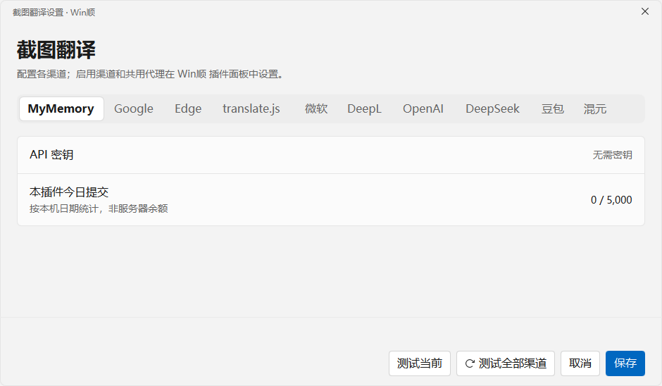
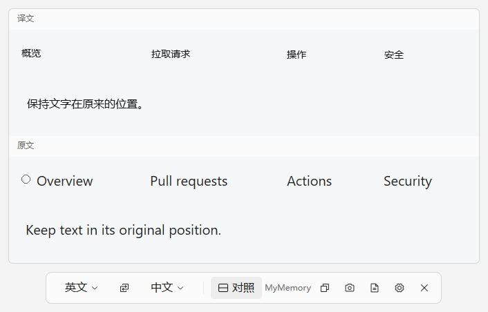

# 截图翻译 / Screenshot Translate

WinShun 截图翻译插件，使用 Windows OCR 识别文字，译文按文字块原位置显示。支持原文对照、剪贴板翻译、独立渠道配置和有记忆的自动降级。

插件 ID：`iuuuuuuuu.screenshot-translate`。这是已收录到 WinShun 插件库的独立社区项目，当前版本 **0.3.3**。

## 界面与安装

使用 Qt/QML，复用 WinShun 的 FlatButton、InputBox、换行选择控件、主题颜色与 Phosphor 图标。设置窗口只编辑各渠道配置；启用渠道、共用代理、自动恢复间隔、对照顺序和点击外部关闭行为由 WinShun 基础插件面板管理。

 

截图由真实新版界面在独立测试桌面渲染，使用合成原图和固定示例译文。

需要 Windows 10/11、Python 3.10+、PySide6-Essentials、Windows PowerShell 5.1、WinShun 0.19.0+ 和至少一种 Windows OCR 语言包。安装界面依赖：

```powershell
python -m pip install --user -r requirements.txt
```

先安装上述依赖，再从 WinShun 插件库更新，或从 [Releases](https://github.com/iuuuuuuuu/winshun-screenshot-translate/releases/tag/v0.3.3) 取得 `.wsplugin`，在 WinShun 设置 → 插件 → 从压缩包安装，检查权限并启用。升级后卡片应显示 **0.3.3**。从 0.2.1 升级时也需要安装新增的 PySide6-Essentials 依赖。插件不会在运行中自动下载依赖或安装 OCR 系统组件。

常驻入口 `broker.py` 不加载 Qt、OCR 或 .NET。框选热键先由轻量原生窗口立即显示双屏蒙版，选定区域后才启动 `main.py --ui-worker` 加载译图界面；启动进程不显示 Windows 忙碌光标。OCR 用系统 PowerShell 执行 `ocr.ps1`，识别结束立即退出。所有译图和设置窗口关闭后，Qt 工作进程立即退出，不等待网络超时或后台线程；Windows 进程作业负责清理其 OCR 子进程。包内没有 EXE、DLL 或字节码，只有 Python、PowerShell、QML、文档和授权字体。

公开版从 0.1.10 升级继续使用同一数据目录与 DPAPI 加密标识。早期本地 `winshun.screenshot-translate` 的数据目录独立，不自动迁移或改写。旧源码保存在 `.native/`，不进入安装包。不要同时启用两个版本，避免入口和热键冲突。

## 使用

| 入口 | 操作 |
|---|---|
| `jst` / `截图翻译` | Enter 框选；Ctrl+Enter 全屏；Shift+Enter 当前窗口 |
| `jft` / `剪贴板翻译` | 留空读取剪贴板，也可输入 `jft hello world` |
| `jsel` / `划词翻译` | 按配置的划词热键读取当前窗口选中文字；默认关闭 |
| `Alt+Shift+T` | 框选截图 |
| `Alt+Shift+C` | 翻译剪贴板 |

每块屏幕分别显示完整框选蒙版，支持跨屏拖选和不同缩放比例。截图后显示识别/翻译动画，工具条位于截图下方，语言菜单在独立窗口中完整展开。对照始终上下排列，默认译文在上，可在 WinShun 插件面板改为原文在上；原图与译图使用同一滚动区域。大图按工作区等比缩放，小图不被工具条撑宽。

Esc 或双击关闭；默认点击其他区域也会关闭贴图，可在 WinShun 插件面板关闭此行为。独立线程接收异步鼠标输入，界面忙时不会阻塞系统点击或丢失关闭通知；贴图、工具条、语言菜单和渠道配置窗口内的点击保留贴图。关闭先隐藏窗口、取消任务，立即释放截图入口。拖动译图同时移动工具条。内容溢出时滚轮滚动，否则调节透明度，Ctrl+滚轮始终调节透明度。右键复制原文/译文、重译、重新截图或查看完整译文。译文保留文字块坐标，邻近图标和数字徽标不重新排版。单块长译文放不下时使用正常字号的换行视图。

翻译失败仍保留识别原文，可以复制、换语言重译或重新截图。忙碌期间重复热键不排队，结束后的新按键立即响应。连续输入取消旧查询后保留最新查询。划词使用 UI Automation，不模拟按键；部分应用不支持。

## 十个渠道

所有渠道在一个互斥选择组中。配置窗口浏览标签或保存不会改变启用渠道。

| 渠道 | 默认地址 | 配置 |
|---|---|---|
| MyMemory | `https://api.mymemory.translated.net/get` | 无密钥；显示本插件今日提交量 |
| Google | `https://translate.googleapis.com/translate_a/single` | 无密钥；浏览器请求头与多 client 重试 |
| Edge | `https://api-edge.cognitive.microsofttranslator.com/translate` | 无密钥；旧取票失败时尝试 Bing 翻译 |
| translate.js / Zvo | `https://api.translate.zvo.cn/translate.json` | 免费无需密钥；企业地址可配置密钥 |
| 微软 Azure | `https://api.cognitive.microsofttranslator.com` | API 密钥和资源区域 |
| DeepL | `https://api-free.deepl.com` | API 密钥；按密钥类型区分免费/付费地址 |
| OpenAI | `https://api.openai.com/v1` | API 密钥、地址、模型，默认 `gpt-4o-mini` |
| DeepSeek | `https://api.deepseek.com` | API 密钥、地址、模型，默认 `deepseek-flash` |
| 豆包 | `https://ark.cn-beijing.volces.com/api/v3` | API 密钥和已开通的模型/接入点 ID |
| 混元 | `https://api.hunyuan.cloud.tencent.com/v1` | API 密钥、地址、模型，默认 `hunyuan-turbos-latest` |

独立设置里的「测试当前」和「测试全部渠道」发送 `Hello world`，使用共用代理，不切换主渠道，也不自动降级，以便准确诊断各服务。全部测试最多同时请求三个渠道，展示每个渠道的成功、错误或未配置结果；使用当前配置草稿，付费渠道未配置密钥时跳过。测试期间可切换配置标签，点击「查看测试结果」返回结果列表。

2026-11-06 本机网络验证：代理出口的 Google、MyMemory 返回 HTTP 429，Edge 旧取票失败，Bing 备选请求返回 HTTP 401。此前五块合成导航截图曾通过 **Google 失败 → translate.js 成功** 返回译文；后续 translate.js 单句测试成功，但多块截图请求和再次单句请求也出现连接失败或超时。因此不保证免费渠道始终在线。界面回归、双屏覆盖、不同 DPI 和 GPU 渲染检查使用合成数据独立验证。付费渠道只做协议验证，未使用真实密钥发起计费请求。

基础选择控件由宿主绘制，插件包无法修改宿主程序。`.host/` 保存本地 WinShun 0.20.0 的换行选择与 eager 插件重载修复源码补丁；需要对应修复的宿主才能使长渠道组始终平铺。该修改没有公开发布为 WinShun 官方版本。

## 自动降级与恢复

默认开启「自动降级」，恢复间隔默认 **10 分钟**，可在 WinShun 插件面板配置 **1–1440 分钟**。

主渠道失败时，尝试 translate.js、MyMemory、Google、Edge，再尝试已有密钥的其他服务；未配置的付费渠道跳过。临时使用的实际服务显示在工具条，鼠标悬停可看恢复说明。共用代理应用于所有尝试，不自动绕过它。

失败渠道与时间保存在 `service-health.json`，关闭窗口、退出插件后仍记得。冷却期内跳过已失败渠道；间隔到后，在下一次翻译中优先重新尝试选定主渠道。不会在空闲时不断访问服务，也不会改写选定主渠道。修改地址、密钥或代理立即重试；缩短恢复间隔也会立即生效。

所有候选都失败时显示错误，不循环请求。单渠道请求通常最多 8 秒，Edge 的页面认证路径最多 14 秒；整次降级请求总预算 20 秒。免费服务会限流，已配置的付费备选可能产生相应服务费用。

## 数据与权限

插件申请 UI、进程、网络、剪贴板读写和数据目录写入权限。截图识别在本机完成；识别文字发送到选定或临时降级的渠道，也可能发送到用户配置的自定义地址。截图本身不上传。

`%LOCALAPPDATA%\WinShun\plugins\iuuuuuuuu.screenshot-translate.data` 保存：

- `services.json`：独立配置，密钥使用 Windows DPAPI 当前用户加密；地址、模型和区域为普通字段。
- `mymemory-usage.json`：按本机日期统计的提交量估算，非服务器余额。
- `service-health.json`：渠道名和失败/恢复时间，配置指纹采用 SHA-256，不记录文字或密钥。

截图仅在工作进程内存中处理，不自动保存截图或 OCR 原文。旧 `shots/` 不自动读取或删除。日志只记录版本、服务、错误类型、状态和文字块数量，不记录请求正文或密钥。

## 验证与限制

```powershell
python -B -m unittest discover -s .tests -v
python -B .tests/qt_probe.py
python -B .tests/qt_probe.py --network
python -B .tests/broker_memory_probe.py 5
python -B .host/package_local.py
```

Qt 视觉/行为验证在从不切换到前台的独立 Windows 桌面运行，使用合成图片和临时配置。网络测试向本机 `127.0.0.1:7890` 代理发送合成文字，不读取个人凭据。官方社区检查器和打包器在隔离的源码副本中运行，不改源仓库暂存区。

Windows OCR 会误识别极小文字、图标和混合语言。位置保留不等于字体、背景像素完全相同；图片/渐变背景、受保护窗口可能产生残影或抓取失败。多块长译文不能保证都在原区域放下，完整文本可查看和复制。

可见窗口期间的工作进程仍可能超过 100 MB；关闭窗口后整个 Qt/OCR 运行时退出，常驻 broker 不保留位图。真实桌面上的框选、跨屏、置顶和快捷键手感仍需人工使用确认，离屏测试不能替代它们。

## English

An independent community plugin listed in the WinShun plugin library, with local Windows OCR, coordinate-preserving overlays, stacked bilingual comparison and independent service profiles. Version 0.3.3 uses a disposable PySide6/QML worker with WinShun controls and Phosphor icons. The resident broker shows native per-monitor selection windows before loading Qt or OCR; outside-click dismissal runs independently of the Qt event loop.

Requires Windows, Python 3.10+, PySide6-Essentials, Windows PowerShell, WinShun 0.19.0+ and installed OCR languages. Install the UI dependency with `python -m pip install --user -r requirements.txt`, then install or update the `.wsplugin` through WinShun. Upgrading from 0.2.1 also requires this new dependency; the plugin never downloads it automatically.

Automatic fallback remembers unavailable services across worker restarts and retries the preferred service on the next translation after a configurable 1–1440 minute interval. It preserves host selection and shows the actual service. Free alternatives and configured paid services may receive recognized text; paid fallback can incur provider charges. Credentials use current-user DPAPI. Screenshots stay local.

Network checks still find rate limits and unavailable Edge/Bing authentication; translate.js availability has also varied between requests. Earlier real OCR with Google failure followed by translate.js success was verified; live paid services were not tested. The plugin's own service settings use wrapping exclusive choices. Long choice groups in the host's basic plugin panel follow the host version's UI behavior.

## 许可

MIT，见 [LICENSE](LICENSE)、[NOTICE.md](NOTICE.md) 和 [THIRD_PARTY_NOTICES.md](THIRD_PARTY_NOTICES.md)。复用的 WinShun 控件与 Phosphor 字体均包含完整 MIT 通知；PySide6 采用其上游 LGPL/商业许可，作为外部依赖安装。包中不包含 Qt DLL 或 WinShun 程序。
